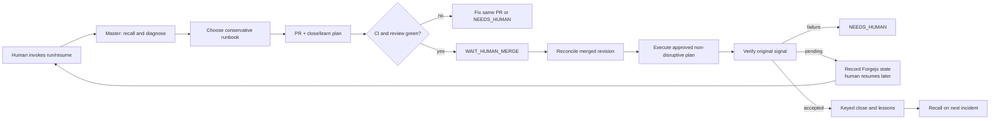

# AI-ops cluster loop

This directory contains command contracts for a supervised incident loop. A human invokes `cluster-aiops run` or `resume`; the master command invokes the subcommands and records their typed results. Forgejo tickets and `learnings/` hold all incident state and memory. The current implementation is not a daemon, has no background force-loop, and does not autonomously wake or chain subcommands.

## Commands

| Command | Role | Mutation boundary |
| --- | --- | --- |
| `cluster-diagnosis` | Read-only evidence collection, ticket correlation, and runbook selection. Starts by recalling matching tickets and `learnings/`. | No cluster, ticket, or file edits. |
| `cluster-remediation` | Implements a conservative fix on a Git branch, tests it, and opens/updates a PR with a head-bound close/learn plan. | Git and PR changes only; no live mutation or auto-merge. |
| `cluster-verification` | Checks the merged revision, rollout, actual configuration, original failure signal, and close readiness. | Strictly read-only; no reconcile, restart, provider activation, scheduler execution, or closure. |
| `cluster-aiops` | Master orchestrator with `run` and `resume`. Coordinates the other commands and records leases, stages, action intents/results, approvals, observation deadlines, closure, and lessons in Forgejo. | May execute only explicitly approved, non-disruptive steps in a merged plan. Heavy operations require `NEEDS_HUMAN` plus `ask`. |

Use environment defaults for every Forgejo operation:

```bash
F="${FORGEJO_URL:-http://nas.homelab.internal:9003}/api/v1/repos/${TICKETS_REPO:-soulwhisper/homelab-tickets}"
TOKEN_FILE="${FORGEJO_TOKEN_FILE:-$HOME/forgejo_tickets.key}"
```

`FORGEJO_TOKEN_FILE` is read without printing it. If it is unavailable, use the existing 1Password fallback. Never put a different repository or credential path in a command.

## Loop design



### State and recovery

Forgejo is the only state and memory backend:

- `aiops-run` comments hold `run_id`, owner, stage, heartbeat, and expiry as recovery/ownership records; they are not compare-and-swap or fencing.
- `aiops-action` comments hold `run_id`, stable `action_id`, head/merge SHA (or `na`), intent/result, and an external artifact reference.
- External artifacts are checked before repeating an action. An intent alone never proves completion.
- `WAIT_HUMAN_MERGE`, upstream merge/release/publication waits, `PENDING_RECONCILE`, `PENDING_SCHEDULED_RUN`, and `WAIT_OBSERVATION` are resumable stages, not active retry loops.
- `NEEDS_HUMAN` records `resume_stage` and the exact decision required. It never invokes automatic remediation.
- `HUMAN_MANAGED` is a finite no-PR terminal outside merged-plan authority, not `DONE`. It records a stable occurrence key, `na` action key, evidence, and reason; the master releases the lease and performs no close, lesson dispatch, or runtime mutation. Resume is a no-op.
- A newer firing event supersedes verification and stops the old run. External closure skips only the close API mutation: learning resumes directly only from an already verified `TICKET_CLOSED`; otherwise merged-plan authorization and class-specific verification/refire checks are still required.

Close and learning have separate idempotent stages:

```text
CLOSE_COMMENT_INTENT
  → CLOSE_COMMENT_WRITTEN
  → TICKET_CLOSING
  → TICKET_CLOSED
  → LESSON_CREATED or LESSON_SKIPPED
  → DONE or LEARN_PENDING
```

`learnings/` is the sole long-term memory. New root causes produce a lesson; recurrences produce a keyed comment on the existing lesson's source ticket. `NO_LESSON` is a successful terminal outcome, not a reason to redispatch forever.

## Human interfaces

Human `run`/`resume` drives every master invocation. Within each invocation, only two decision interfaces are intended:

1. **Merge the PR.** Before merge, CI and review must be green and the PR body plus ticket comment must contain matching close/learn plans bound to the exact head SHA. After merge, the orchestrator reads the actual merge SHA, confirms it is the merge of that PR and approved head, and rechecks the same unchanged plans before every plan-authorized operation, close, or lesson dispatch. A merge authorizes only the exact non-disruptive operations listed there.
2. **Resolve `NEEDS_HUMAN`.** This covers unknown runbooks, verification failure, refire, missing prerequisites, unapproved operations, and heavy-impact actions. Heavy operations additionally require the `homelab-gitops` risk/recovery disclosure and `ask`.

Do not bypass these interfaces with auto-merge, direct `kubectl apply/edit/delete`, extra approval prompts, or repeated content-denied canaries.

## Current boundaries

- A human invokes every `run` or `resume`. Pending stages are Forgejo recovery records, not active retry loops.
- There is no background force-loop, wake-up scheduler, or automated hard-gate enforcement. The state machine and approval checks are contracts followed by the human-driven master, not a runtime enforcement service.
- Forgejo comments do not provide transactional compare-and-swap or fencing. The operator must avoid concurrent master invocations for the same ticket; the current model claims no automated mutual exclusion.
- Existing PRs are not proof that merged plans, verification, or close/learn are complete. They still require runtime verification.
- Heavy operations, unapproved runtime work, unknown runbooks, and incidents without sufficient evidence remain explicit supervised decisions; they are not silently forced through the loop.
- The current runbooks cover recent incident classes; unknown classes return `no_recommendation` for the master instead of guessing.
- After changing `infrastructure/forgejo`, `just forgejo sync` remains a required operator step to update the actual tickets repo.

## Current detection gaps

These intake coverage and reliability boundaries remain outside the supervised command contracts:

- Ticket creation accepts only `PROMETHEUS` findings normalized to MEDIUM/HIGH. Lower-severity findings are outside the ticket loop and have no guaranteed notification path; separately routed Alertmanager alerts may still notify. Watchdog, blackholed alerts, and inhibited warnings intentionally do not enter this loop.
- Robusta builtin OOM/CrashLoop/ImagePull/Evicted findings do not enter the ticket loop. The webhook-relay comment says they still reach Feishu, but the Robusta→Feishu route is disabled and Robusta has only the tickets sink. Corresponding Prometheus alerts may provide separate coverage; the builtin findings themselves have no independent notification path in the current configuration.
- Intake has no durable queue, dead-letter store, or backfill scan. Short relay retries, delivery backpressure, or a consumer outage can lose a finding before its Forgejo marker exists; a later unmatched resolution does not recreate the incident.
- Holmes investigation is best-effort: its queue is in-memory and bounded, and investigation/comment failures have no retry or dead-letter path. A missing Holmes comment is not evidence of diagnosis or healing.
- Ticket intake and Holmes do not invoke the master. A human starts `cluster-aiops run` or `resume`; this is an intentional supervised boundary, not an automatic trigger failure.

## Future work: forced loop and enforced gates

These are not current capabilities or prerequisites for the supervised loop. If autonomous execution is added later, build a small executor around `cluster-aiops`, not another orchestration framework:

1. **Serialized workers:** hold an exclusive per-ticket executor serialization lock for the entire `run`/`resume` invocation before any external side effect. A single-process queue or single-host `flock` is valid. Keep Forgejo run/action records for ownership, crash recovery, and idempotency, and acquire the same serialization before expired-run recovery.
2. **Wake-up sources:** GitHub merge webhooks, periodic scans of open tickets, and `next_check_at` timers for pending/reconcile/observation stages. Never poll in a tight loop or retry content-denied tools.
3. **Fixed invocation API:** call `cluster-aiops run <ticket>` for new incidents and `cluster-aiops resume <ticket>` for every pending stage. Do not duplicate the state machine in executor code.
4. **Enforced automation gates:** execute automatically only through CI-green, human-merged, non-disruptive, verified stages. `NEEDS_HUMAN` and heavy operations stop the worker and notify a human; they never auto-resume.
5. **Configuration:** default dry-run. Explicitly enable PR creation and non-disruptive live steps separately, for example `AIOPS_EXECUTE=1` and `AIOPS_APPROVED_LIVE=1`, using the same Forgejo environment defaults.
6. **Observability:** expose run/stage/result metrics, idempotency skips, workflow run IDs, and failure reasons without secrets or raw payloads. Rate-limit canaries and preserve guardrail `FailClosed` behavior.
7. **Pilot:** run one non-disruptive incident end-to-end before enabling the executor for all tickets. Prove merge wait, resume after merge, refire invalidation, crash recovery, `NO_LESSON`, recurrence, and close/learn completion.

The current subcommands instead provide complete typed results so the supervised master can finish or explicitly yield with Forgejo state, without depending on these future enforcement mechanisms.
