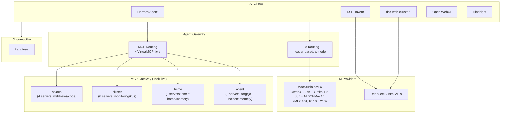

# AI Infrastructure Summary
Last updated: 2026-10-28

Source: Flux manifests in `kubernetes/apps/`.

## Architecture Overview



## Agent Gateway — Central LLM + MCP Router

The agent gateway is the single entry point for all agentgateway-managed LLM lanes and MCP traffic. UI-configured external providers (DeepSeek and Kimi) connect directly from DSH apps; Hermes always uses the gateway for LLM and MCP calls.

### LLM lanes

One route, one path: `POST /v1/chat/completions`. The guarded/open split is
a **model name** (body `model` → `x-model` header via the gateway-wide
PreRouting transform); guardrails attach to the guarded rules by section
name:

| Client model | promptGuard | Backend | Model (studio id) |
| ------------ | ----------- | ------- | ----------------- |
| `uncensored` | none (open lane) | `llm-backend-complex` | Qwen3.8-27B Uncensored (`qwen3.8-27b`, MLX 4bit) — pure chat only |
| `agent` | **guarded** | `llm-backend-agent` | Ornith-1.5-35B (`ornith-1.5-35b-a3b`, MLX 4bit) — AI-ops automation |
| `omni` | **guarded** | `llm-backend-omni` | MiniCPM-O-4.5 (`minicpm-o-4.5`, text+vision+audio-in) |

Consumer base URLs
are `.../v1` — OpenAI/litellm clients append `/chat/completions`
themselves; raw-HTTP consumers must use the full path.

There is no catch-all: an unknown or missing model id matches no rule and
the gateway answers `404`. `uncensored` is the only unguarded model — the
single uncensored brain. `omni` is reachable exclusively
guarded. All backends
speak the OpenAI-compatible API on `studio.homelab.internal:8000` and
inject the oMLX server key via `policies.auth.secretRef`
(`studio-api-auth`). Consumers authenticate with **per-lane** API keys
(ExternalSecret-managed from the 1Password `agentgateway` item; format
`llm-<lane>-<hex16>`): `llm_uncensored` (human chat), `llm_agent` (hermes,
robusta), `llm_omni` (extractors). Each lane rule carries its own
apiKeyAuthentication policy (sectionName-scoped), so a chat key cannot call
the automation lane. Cross-lane needs are served by enrolling the same key
in another lane's secret, never by sharing a policy: `llm-omni-auth` also
enrolls the agent key (hermes aux) and the uncensored key (dsh-tavern background
generation and open-webui auxiliary tasks); `llm-media-auth` enrolls the omni key (karakeep/hindsight
embeddings+rerank). Revocation = remove the entry from every lane secret.
There is no cloud fallback — the studio is a deliberate SPOF.


MCP has no open route (see MCP Backend).


Lane-fit guidance: `omni` covers everything fidelity-sensitive: summarization, compression, session search, memory writes, OCR/vision, plus classification, tagging, title/routing decisions and short structured extraction. `agent` for AI-ops automation: alert RCA, ScheduledHealthChecks, MCP batch tool workloads. `uncensored` for pure human chat (RP/creative/open-ended) only.

`omni` uses **MiniCPM-O-4.5** (Apache-2.0, 9B omni: Qwen3-8B backbone + vision/audio encoders; OpenCompass 77.6, OCRBench 876) served on the studio (studio id `minicpm-o-4.5`, ~7 GB at MLX 4bit). All `fast`/`memory`/`vision` consumers (firecrawl, karakeep text+image, home-assistant-sgcc OCR, hindsight memory, trendradar digest, frigate event descriptions (native GenAI), hermes aux side-tasks) use `omni`. Not on omni: `agent` (automation main brain), `uncensored` (pure-chat brain), embeddings/reranker (studio ids `qwen3-embedding-0.6b`/`qwen3-reranker-0.6b`). ASR: no deployment — no current consumer; when one appears, pick a lane deliberately.

### Intranet exposure

The gateway API surface is exposed to the intranet via `kgateway-internal` (10.10.0.131) at `https://api.noirprime.com` (`/v1/*`, `/mcp`; dashboard stays on `https://ai.noirprime.com/ui`):

- `/v1/chat/completions` — LLM lanes (strict API key; promptGuard on all but `uncensored`)
- `/v1/models` — gateway-synthesized lane discovery (`studio-models` directResponse; keep in sync with Studio Model Registry)
- `/v1/embeddings`, `/v1/rerank`, `/v1/audio/*` — media lanes via LLM-pipeline backends (strict API key)
- `/mcp/search`, `/mcp/cluster`, `/mcp/home`, `/mcp/agent` — tiered MCP routing (per-tier API key; mcp-guardrails ExtMCP on the search + agent tiers, FailClosed)
  (dashboard UI lives separately at `https://ai.noirprime.com/ui`)

TLS terminates at kgateway (cert-manager `noirprime-com-tls`, wildcard `*.noirprime.com`); external-dns auto-creates the AdGuardHome record. Machine clients authenticate with agentgateway API keys — no SSO extAuth on API paths. Reachable from trusted VLANs (10/100/200); IoT VLAN 210 is ACL-blocked from RFC1918.

### App → model lane

| App                  | Lane              | Model              | Notes                                                        |
| -------------------- | ----------------- | ------------------ | ------------------------------------------------------------ |
| hermes-agent         | `agent`           | Ornith-1.5-35B | Agent brain: automation / KB QA / ops batching; aux side-tasks on `omni` (GitOps configmap) |
| robusta (holmes)     | `agent`           | Ornith-1.5-35B      | Alert RCA + ScheduledHealthChecks; 32K client context cap bounds oMLX prefill memory; temperature 0.6 per model tuning |
| hindsight            | `omni`            | MiniCPM-o 4.5      | Extraction-dominant (single-model constraint); embeddings + reranker via gateway media routes |
| firecrawl            | `omni`            | MiniCPM-o 4.5      | Batch page extraction/summarization                          |
| karakeep             | `omni`            | MiniCPM-o 4.5      | Text + image tagging (unified); embeddings via `/v1/embeddings` (model `embedding`, 1024d) |
| trendradar           | `omni`            | MiniCPM-o 4.5      | News digest (`openai/omni`); queryable via the `search` MCP tier |
| home-assistant-sgcc  | `omni`            | MiniCPM-o 4.5      | Meter/bill photo OCR                                         |
| dsh-tavern           | `uncensored`      | Qwen3.8-27B        | RP portal (dsh-tavern image); model/key UI-configured on PVC |
| dsh-web              | `agent`/`omni`    | Ornith-1.5 / MiniCPM-o | Agent workbench (servitor-apps); LLM lanes + search tier MCP (`mcp_search` key, `/mcp/search`) |
| open-webui           | `uncensored`/`omni` | Qwen3.8-27B / MiniCPM-o | Human chat portal; search-tier MCP and OTEL traces |

Both DSH apps also expose the optional `kimi` provider (`https://api.moonshot.ai/v1`, model `kimi-k3.1-pro`). It is a direct external provider, not an agentgateway lane, and does not override the default model.

All `omni` consumers (extractors + hermes aux) ride the **guarded**
`/v1` lane; their prompts carry scraped web content, so a low rate of
promptGuard false-positive rejections (403) is expected and watched — see
the TODO table.

### MCP Backend — tiered, guarded, no open lane

One gateway route per ToolHive group, each with its **own credential** —
group ↔ route ↔ key are bound 1:1:1 (every rule rewrites its tier prefix to
the canonical `/mcp` upstream):

| Route          | vmcp          | Servers (aggregated)                                          | Key (1Password `agentgateway`) | Issued to                    |
| -------------- | ------------- | ------------------------------------------------------------- | ------------------------------ | ---------------------------- |
| `/mcp/search`  | `vmcp-search` | firecrawl, context7, trendradar, github (read-only)           | `mcp_search`                   | hermes, open-webui, dsh-web     |
| `/mcp/cluster` | `vmcp-cluster`| kubernetes, fluxcd, grafana, victoria-logs/-metrics/-traces   | `mcp_cluster`                  | hermes, dsh-web                      |
| `/mcp/home`    | `vmcp-home`   | home-assistant, hindsight-home bank                           | `mcp_home`                     | hermes, dsh-web                      |
| `/mcp/agent`   | `vmcp-agent`  | forgejo (ticket RW), hindsight-ops bank                       | `mcp_agent`                    | hermes, external operator agents |

A key minted for one group is invalid on every other route — this is what
scopes the search consumer to search and keeps chat-tier consumers out of incident
memory and the tickets repo. `mcp_agent` is never distributed to in-cluster
chat apps. **Grouping rule:** create a group only for a new consumer or a
new permission class; a new server joins the matching existing group.

**Tool filtering** lives at the gateway (`backend.mcp.authorization` CEL,
Allow = default-deny; `config/mcp/filters.yaml`), not toolhive — toolhive's
filter middleware is broken for vmcp Modern backends (SEP-2322 envelope
loss, 2026-10-10). Only servers without an upstream token boundary are
CEL-filtered (firecrawl, trendradar, grafana, victoria-metrics); github,
forgejo, kubernetes, fluxcd are bounded by their upstream tokens/SAs and
full-allowed by prefix. Allowlists are version-tracked: each filtered
server's `mcpserver.yaml` names the image tag the tool names were
enumerated from (live, 2026-10-20) — re-verify on every renovate bump.
This requires the vmcp **optimizer to stay off**: it masks real tool names
behind `find_tool`/`call_tool` meta-tools that gateway authorization cannot
see through (removed 2026-10; also dropped the vmcp embeddings dependency).

The **search and agent backends only** carry the mcp-guardrails ExtMCP sidecar
(agentgateway `mcp.guardrails`): `tools/call` is scanned request+response,
`tools/list` skips the response scan on both tiers (the catalog is
operator-authored config, not untrusted content), while `prompts/get` /
`resources/read` stay response-only;
`failureMode: FailClosed` (the sidecar being down disables those two tiers
rather than passing them unguarded). Scope decision (2026-10-20): search is
the tier where untrusted web content reaches an unguarded lane (dsh-tavern /
any `uncensored`-lane consumer); the agent tier's consumers are operator agents (including hermes) with
no cluster-side promptGuard in front of them, and forgejo ticket bodies
carry alert/log-derived (untrusted) strings. cluster/home consumers (hermes)
ride the guarded `agent` LLM lane — cluster adds CEL allowlists and
token/SA boundaries, home is RW-by-design behind the HA token — so the
sidecar there was duplication, and its FailClosed posture made one sidecar
an outage for all of MCP.
Response scanning uses four balanced windows (11KiB
by default) with a 3.5s scanner deadline and a 15s Service-scoped ExtMCP
callout deadline; readiness completes a full-size warmup before traffic.
There is deliberately **no** unguarded MCP route. Direct vmcp
access is cilium-restricted to the gateway federation and vmagent metrics
(exception: `kubectl port-forward` reaches the anonymous vmcp endpoint by
design of the kubelet path — acceptable, it is RBAC-gated; harden via vmcp
`incomingAuth` if that ever changes).
---

## LLM Inference — Local

All lanes run on the MacStudio inference host (`uncensored` Qwen3.8-27B, `agent` Ornith-1.5-35B, `omni` MiniCPM-o 4.5). The in-cluster llama.cpp deployment (`llama-qwen3`) was archived 2026-08-28; its 50Gi CephFS PVC `llama` is retained for manual cleanup. Qwen3.5-4B was retired 2026-09-09 with the `fast`/`memory`/`vision` lane removal.

---

## AI Agent Platform

### Hermes Agent

Runs `ghcr.io/soulwhisper/hermes-agent` — the upstream image plus baked
extras (rtk, caveman skills, feishu deps), supervisord-managed `gateway` +
`dashboard` in one container. Tag tracks upstream semver releases.

| Component | Port | Notes                       |
| --------- | ---- | --------------------------- |
| Dashboard | 9119 | SSO-protected               |
| Gateway   | 8642 | Internal, health: `/health` |

- **Runtime**: user namespaces (`hostUsers: false`) + egress CNP (ADR-03; Kata removed)
- **Resources**: req: 200m CPU / 1Gi RAM, lim: 4Gi RAM
- **Integrations**: Feishu (plugin `plugins/platforms/feishu`, WebSocket mode, the only messaging platform), Firecrawl (internal), ToolHive MCP (`search`+`cluster`+`home`+`agent` tiers, declarative `mcp_servers` in the configmap), Agent Gateway LLM
- **Egress**: CiliumNetworkPolicy — agentgateway-proxy:80 (L7: POST `/v1/*` + `/mcp/*` only), kube-dns, world-except-private :443 (Feishu WebSocket). No direct vmcp access — MCP goes through the guarded tiered `/mcp/*` endpoints like every other client
- **Ingress**: caller-scoped CNP (#3934) — dashboard :9119 + webhook ingest :8644 via kgateway-internal (shared rule), webhook ingest :8644 also from frigate + LAN, profile API :8642 same-namespace only; `fromEntities: host` keeps kubelet probes working
- **Depends on**: `agentgateway` (Flux dependency)
- **Profiles** (seeded declaratively by the `seed-config` initContainer from `configmap.yaml`; dashboard edits to `config.yaml`/profile files revert on restart):
  - `ops` — the batching brain: cron/Feishu/automation workload lives here (search, cluster read-only, home read-write, and agent ticket/incident-memory MCP tiers); owns the Feishu adapter, credentials, home channel and new Feishu sessions
  - `default` — fallback/scratch with no Feishu adapter; the retired `chat` profile was removed 2026-10 when the human interface moved to dedicated portals
  Model/provider config (`model.provider: custom` → agent gateway, `model.default: agent`) and aux side-tasks (`vision`/`web_extract`/`session_search`/`compression`/`title_generation` → `omni`) are GitOps-managed in `configmap.yaml`; the gateway's PreRouting transformation maps body `model` → `x-model` header, so lane names are model names. Requires 1Password `hermes-agent` field: `api_server_key_root` (>=16 chars)

---

### Open WebUI

- Human chat portal, image `ghcr.io/open-webui/open-webui:v0.12.4`. Lives in **servitor-apps**
- **Auth**: Authentik forward-auth gates access at the gateway; with no trusted-header mapping, Open WebUI login is disabled and requests use its shared local system account
- **Ingress**: `chat.noirprime.com` via kgateway-internal
- **LLM**: single agentgateway OpenAI provider; `uncensored` for chat and `omni` for guarded auxiliary tasks
- **MCP**: native search-tier connection through `/mcp/search` with the `mcp_search` bearer key
- **State**: shared CNPG for app data and pgvector, app Dragonfly for session/rate-limit state, and the `open-webui` Ceph bucket for uploads and KB files; the data directory is cache-only
- **Egress**: agentgateway, CNPG, Dragonfly, Ceph RGW, OTLP collector, kube-dns, and world-except-private for RAG fetching

### DSH Web

- Agent workbench, image `ghcr.io/soulwhisper/dsh-web` (DSH Web + `dshmarket` + required forward-auth). Lives in **servitor-apps**
- **Auth**: Authentik forward-auth at the gateway; the blueprint owns group authorization. The app consumes the stable owner subject from the `app-user` ExternalSecret and no longer references Authentik groups. No startup-token or local-password fallback
- **Ingress**: `dsh.noirprime.com` via kgateway-internal
- **State**: kopiur-backed PVC `dsh-web` at `/data`; `/workspace` is a subPath on the same claim. `/cache`, `/logs` and `/backups` share the `dsh-web-cache` `ceph-cache` PVC; `/tmp` remains emptyDir
- **MCP/Skills**: the `dsh-web-mcp` ExternalSecret is mounted as `/data/dsh/cordis.patch.yml` for the guarded search, cluster and home tiers (`/mcp/search`, `/mcp/cluster`, `/mcp/home` with `mcp_search`, `mcp_cluster`, `mcp_home`, never in Git). Native skill roots are `<workspace>/.dsh/skills`, `<workspace>/.agents/skills`, `$DSH_HOME/skills` and `$DSH_AGENTS_HOME/skills`; register `/workspace` as the DSH workspace, not `/data/home`.
- **LLM/MCP**: UI-selectable agentgateway, DeepSeek and Kimi providers; MCP uses the guarded tiers. No default model is pinned
- **Egress**: CiliumNetworkPolicy — agentgateway-proxy:80 (`/v1/*` + `/mcp/*`), world-except-private :443 for direct DeepSeek/Kimi LLM calls and the user-driven plugin market, kube-dns

### DSH Tavern

- RP chat portal, image `ghcr.io/soulwhisper/dsh-tavern` (dsh-tavern profile + eco plugins baked). Lives in **servitor-apps**
- **LLM**: UI-selectable uncensored/omni gateway lanes plus direct DeepSeek and Kimi providers; no default model is pinned
- **Auth**: Authentik forward-auth at the gateway; the blueprint owns group authorization. The app consumes the stable owner subject from the `app-user` ExternalSecret and no longer references Authentik groups. No startup-token or local-password fallback
- **Ingress**: `tavern.noirprime.com` via kgateway-internal
- **Egress**: CiliumNetworkPolicy — agentgateway-proxy:80 (LLM only), world-except-private :443 for direct DeepSeek/Kimi LLM calls, card/preset fetches and tavern-image backends, kube-dns
- **State**: kopiur-backed PVC `dsh-tavern` at `/data`; `/workspace` is a subPath on the same claim. `/cache`, `/logs` and `/backups` share the `dsh-tavern-cache` `ceph-cache` PVC; `/tmp` remains emptyDir

### Media lanes (studio-hosted, OpenAI-compatible)

Non-chat vector modalities run on the same oMLX process as the chat lanes, exposed on `agentgateway-media-route` through the **LLM pipeline** (no more static passthrough): each lane is an `AgentgatewayBackend` with a `custom` provider declaring exactly one API format, guarded by the `llm-media-auth` API key (omni key enrolled):

| Path             | Backend             | Client model | Upstream (override)      | Model                                   | Timeout |
| ---------------- | ------------------- | ------------ | ------------------------ | --------------------------------------- | ------- |
| `/v1/embeddings` | `studio-embeddings` | `embedding`  | `qwen3-embedding-0.6b`   | Qwen3-Embedding-0.6B (1024d)            | 120s    |
| `/v1/rerank`     | `studio-rerank`     | `reranker`   | `qwen3-reranker-0.6b`    | Qwen3-Reranker-0.6B (Cohere-compatible) | 120s    |
| `/v1/audio/*`    | `studio-audio`      | `voxcpm2`    | (passthrough — no override) | VoxCPM2 (TTS)                           | 300s    |

The ComfyUI `image`/`voice` lanes (`:8001`) stay retired — plain passthrough gains nothing from gateway policy; the qwen-image-2.1 download sits parked (see Studio Model Registry). `/v1/audio/transcriptions` (ASR) is wired on the audio backend but has no consumer yet. Passthrough applies no LLM parsing — the audio lane has no model override, so clients send the folder id `voxcpm2` (unlike embeddings/rerank aliases).

Config: `kubernetes/apps/networking-system/agentgateway/config/media/` — backends + route on `agentgateway-proxy`. Clients use `https://api.noirprime.com` as base URL with the omni lane key (`llm_omni`, enrolled in `llm-media-auth`) — each media backend injects the oMLX server key upstream via `policies.auth.secretRef: studio-api-auth`, identical to the chat lanes (single credential model: the studio key never leaves the backends). **Consumers**: embeddings — karakeep, hindsight; rerank — **hindsight only**; audio — none yet (TTS lane ready). The direct-to-studio blackbox probe reads the oMLX key via `credentials_file` — API-plane only (`GET /v1/models`): per-model inference probes were removed because oMLX auto-loads models and evicts KV on TTL. karakeep and hindsight vector stores were rebuilt for the 0.6B/1024d embedding space (no data was preserved).

---

## MCP Gateway

### ToolHive

- **Operator**: namespace-scoped RBAC
- **4 Virtual MCP Servers** (search / cluster / home / agent) with:
  - Circuit breaker (3 failures → 30s timeout)
  - OTEL telemetry (5% sampling)
  - **No optimizer** (removed 2026-10): it hid real tool names behind
    `find_tool`/`call_tool` meta-tools, blocking gateway-level tool
    filtering; its removal also dropped the vmcp embeddings dependency
  - Daily restarter CronJob caps the runner's ~9Mi/h streamable-http leak
    across all four groups (homelab-tickets#59)
- **Ingress restricted**: only agentgateway-proxy (MCP protocol, tiered `/mcp/*`) and vmagent (metrics scrape) can connect; chat frontends reach tools through the gateway, never directly

### MCP Servers (14 total)

#### search (web/docs/news/codebase retrieval — hermes, open-webui, dsh-web)

| Server    | Transport             | Notes                    |
| --------- | --------------------- | ------------------------ |
| firecrawl | Streamable HTTP :8080 | Local Firecrawl instance; gateway-filtered to retrieval tools |
| context7  | stdio :3000           | Context7 API (2 read tools) |
| trendradar | Streamable HTTP :8080 (proxy→:3333) | TrendRadar news DB; gateway-filtered to query/analysis (no trigger/notify) |
| github    | HTTP :8082            | Read-only PAT + lockdown, toolsets repos/issues/pull_requests; the token is the boundary (no CEL) |

#### cluster (read-only, no egress — hermes)

| Server        | Transport             | Connects To                   |
| ------------- | --------------------- | ----------------------------- |
| kubernetes    | HTTP :8080            | kube-apiserver (read-only SA) |
| fluxcd        | HTTP :9090            | Flux (read-only SA)           |
| grafana       | Streamable HTTP :8000 | Grafana (read-only SA + `--disable-write`; gateway-filtered: no `grafana_api_request`/manage/provisioning) |
| victoria-logs | Streamable HTTP :8081 | VictoriaLogs                  |
| victoria-metrics | Streamable HTTP :8081 | VictoriaMetrics; gateway-filtered to the query surface |
| victoria-traces | Streamable HTTP :8081 | VictoriaTraces                |

#### home (read-write, no egress — hermes)

| Server         | Transport            | Connects To            |
| -------------- | -------------------- | ---------------------- |
| home-assistant | HTTP (FastMCP) :8086 | Home Assistant         |
| hindsight-home | HTTP proxy :8080     | Hindsight `home` bank (single-bank MCPToolConfig; description overrides stay at toolhive) |

#### agent (operator agents only)

| Server       | Transport             | Notes                                       |
| ------------ | --------------------- | ------------------------------------------- |
| forgejo      | Streamable HTTP :8080 | Forgejo on nas:9003 via forgejo-mcp; forwarded repo-scoped `pat_tickets` — the Forgejo-side token scope is the security boundary (no CEL) |
| hindsight-ops | Streamable HTTP :8080 (proxy→:8888) | Hindsight `ops` bank; incident/RCA memory, no chat-tier consumers |

Forgejo's `pat_tickets` retains repository-write scope for the manual lessons
workflow, so the guard is the token's Forgejo-side permission scope itself.
A model-facing `MCPToolConfig` allowlist was tried and removed the same day
(2026-10-10): toolhive v0.51.4's filter middleware re-encodes `tools/list`
through a lossy struct that strips the SEP-2322 `resultType` envelope, which
vmcp rejects for Modern-era backends — the forgejo backend circuit-broke out
of its group until the filter was dropped. Permission filtering now lives at
the gateway where needed (see filters.yaml); toolhive `MCPToolConfig` is
kept ONLY for the hindsight banks' description overrides. No draftbox or
broad user PAT was provisioned.

#### Obsidian facts workflow

Plain-text pipeline, no extra copies: Obsidian → Dropbox (canonical; its own sync/revisions) → Synology CloudSync pull → `/volume1/backup` on the NAS. Agent-authored notes never write into the vault copy; they currently have no versioned landing zone — promotion into the vault is manual.

---

## LLM Observability

### Langfuse

| Component | Image                                      | Resources            |
| --------- | ------------------------------------------ | -------------------- |
| web       | `ghcr.io/langfuse/langfuse`        | req: 1 CPU, lim: 2Gi |
| worker    | `ghcr.io/langfuse/langfuse-worker` | req: 2 CPU, lim: 4Gi |

- **Backends**: ClickHouse (analytics), Dragonfly Redis (cache/queue), Ceph S3 (events/exports), CloudNativePG (metadata)
- **Features**: Experimental features enabled, telemetry disabled

---


### TrendRadar

- AI news digest pipeline (selfhosted-apps): community hot-list (47 sources, issue #95) + custom RSS watch list (aiera.com.cn, expreview.com + GitHub Atom placeholders); `report.mode: incremental` (zero-duplicate push), keyword grouping (科技 topic covers both portals), AI analysis via gateway (`openai/omni`)
- Delivery: Feishu custom group robot (`FEISHU_WEBHOOK_URL` from 1Password `feishu.newsbot_webhook`); HTML report at `news.noirprime.com` (SSO)
- MCP server (:3333) registered as `trendradar` in the `search` group (gateway-filtered to query/analysis tools; consumed by hermes, open-webui, and dsh-web)
- Config fully in ConfigMap (`config.yaml` + `frequency_words.txt` + `ai_interests.txt`); output on 1Gi ceph-block PVC

## AI-Adjacent Services

### Vision alerting (frigate-vision)

Frigate is the 24/7 trigger layer AND the event describer: 0.18 native GenAI (`objects.genai`, multi-frame, per-camera/object prompts) runs on an openai-compatible provider pointed at the `omni` lane (MiniCPM-o 4.5, `descriptions` role). The caption prompt instructs the model to start with a `[low|medium|high]` severity prefix. Frigate config (provider + per-camera GenAI toggle) lives in the Frigate UI/DB — it is not GitOps-managed. `smarthome-apps/frigate-vision` is a slim forwarder only (python, ConfigMap-mounted): MQTT `frigate/tracked_object_update` (`type: description`) → parse severity prefix → gate on `MIN_SEVERITY` (default medium) → enrich via frigate `GET /api/events/{id}` → hermes webhook `POST :8644/p/ops/webhooks/frigate-alert` (V2 HMAC) — the `ops` profile ingests it as a user message, so the batching brain sees camera events in context with everything else it knows. Webhook route is declared in the GitOps-managed default `config.yaml` (`platforms.webhook.extra.routes`, HMAC secret via `FRIGATE_WEBHOOK_SECRET` in 1Password). The HA `persistent_notification` leg is an HA-side MQTT automation on the same description messages (UI-managed, not GitOps). 1Password additions: `hermes-agent.webhook_secret_frigate`.

### Firecrawl

- Web scraping pipeline for AI data ingestion
- 3 containers: api (:3002), nuq-worker (:3006), playwright-service (:3000)
- `ghcr.io/firecrawl/firecrawl` (api + nuq-worker; playwright-service pinned by digest), sandboxed per ADR-03 (`hostUsers: false` + egress CNP)
- Backed by SearXNG, Dragonfly Redis, nuq-postgres
- Exposed as MCP server + internal endpoint for Hermes

### Hindsight

- AI memory / context store (agent long-term memory: retain / recall / reflect)
- Image: upstream `ghcr.io/vectorize-io/hindsight` (slim variant) — no in-process local-ml
- LLM: `omni` lane → **MiniCPM-O-4.5 on the MacStudio** (via agentgateway `/v1/chat/completions`)
- Embeddings: **Qwen3-Embedding-0.6B on the MacStudio** (oMLX id `qwen3-embedding-0.6b`, 1024d) via gateway `/v1/embeddings`; store rebuilt from scratch for the 0.6B space
- Reranker: **Qwen3-Reranker-0.6B on the MacStudio** (Cohere-compatible, id `qwen3-reranker-0.6b`) via gateway `/v1/rerank`
- Resources: req: 200m CPU / 512Mi, lim: 2 CPU / 2Gi
- Storage: CloudNativePG (vchord vector + pgroonga text search), OTEL enabled
- Exposed as MCP server for agent context retrieval

### Archived

- **Buzz** (relay + buzz-agent-omp) — buzz-agent-omp removed 2026-08-28; buzz-relay removed 2026-09-09, superseded by hermes' native webhook ingestion (`/p/<profile>/webhooks/<route>`, HMAC); manifests deleted from git. Its CNPG DB, Dragonfly, and Ceph bucket are retained in-cluster for manual cleanup.
- **Fast-Note-Sync** — removed 2026-09-09, manifests deleted from git; the draftbox-via-forgejo-MCP successor was never implemented and is dropped. Dropbox MCP was evaluated and rejected (beta, DCR-limited clients, short-lived tokens, cloud round-trip for local data)
- **Devbox** — removed from cluster 2026-08-05; image retained in `soulwhisper/containers` as an ad-hoc exec sandbox.
- **llama.cpp (llama-qwen3)** — archived 2026-08-28; all local lanes moved to the MacStudio.

---

## Shared Infrastructure (all AI apps depend on)

| Service                     | Namespace           | Purpose                                             |
| --------------------------- | ------------------- | --------------------------------------------------- |
| **Agent Gateway**           | `networking-system` | LLM + MCP routing                                   |
| **CloudNativePG**           | `database-system`   | PostgreSQL + PGVector for Langfuse, Hindsight |
| **Dragonfly**               | Various             | Redis-compatible cache/queue                        |
| **ClickHouse**              | `database-system`   | Langfuse analytics                                  |
| **Ceph (Rook)**             | `storage-system`    | S3 + block + CephFS for model/data storage          |
| **Workload sandboxing**      | —                   | user namespaces + egress CNP per ADR-03 (Kata removed)  |
| **kgateway**                | `networking-system` | API gateway + SSO extAuth                           |
| **Authentik**               | `security-system`   | SSO for all public AI endpoints                     |
| **Cert-Manager**            | `security-system`   | TLS certificates                                    |
| **VictoriaMetrics**         | `monitoring-system` | Metrics for ToolHive + OTEL                         |
| **OpenTelemetry Collector** | `monitoring-system` | Traces/metrics pipeline                             |

The host-side contract. oMLX serves each model under its **folder name**
in `~/models/` — the folder name IS the API-visible model id (there is no
oMLX-side alias layer). Chat lane names (`uncensored`/`agent`/`omni`) map to folder ids via each backend's `openai.model` override
(`kubernetes/apps/networking-system/agentgateway/config/llm/`). Media
lanes: clients send `embedding` / `reranker` and the media backends'
`custom.model` override rewrites them to folder ids; the audio lane is a
passthrough exception — clients send `voxcpm2` directly. Folder ids are
only needed for direct-to-studio calls.

**Auth**: oMLX enforces a server API key (1Password item `omlx`, field
`api_key`). Every backend — chat and media alike — injects it upstream via
`policies.auth.secretRef: studio-api-auth`; consumers always present a
per-lane gateway key (`agentgateway` item, `llm_<lane>` fields). The studio
key never leaves the backends.

Alignment table (keep in sync with the bootstrap downloads):

| Order | Lane        | Studio id (folder)       | Model                        | HF source                                   | Format / size   | Served by |
| ----- | ----------- | ------------------------ | ---------------------------- | ------------------------------------------- | --------------- | --------- |
| 1     | `uncensored` | `qwen3.8-27b`           | Qwen3.8-27B Uncensored       | `orcarouter/Qwen3.8-27B-Uncensored-MLX`     | MLX 4bit, ~15.7G | oMLX :8000 |
| 2     | `agent`     | `ornith-1.5-35b-a3b`     | Ornith-1.5-35B               | DeepReinforce Ornith-1.5-35B, local MLX 4bit conversion | MLX 4bit, ~19G | oMLX :8000 |
| 3     | `omni`      | `minicpm-o-4.5`          | MiniCPM-O-4.5                | `mlx-community/MiniCPM-o-4_5-4bit`          | MLX 4bit, ~7G   | oMLX :8000 |
| 4     | `embedding` | `qwen3-embedding-0.6b`   | Qwen3-Embedding-0.6B (1024d) | `mlx-community/Qwen3-Embedding-0.6B-4bit-DWQ` | MLX, ~1.3G    | oMLX :8000 (`/v1/embeddings`) |
| 5     | `reranker`  | `qwen3-reranker-0.6b`    | Qwen3-Reranker-0.6B          | `mlx-community/Qwen3-Reranker-0.6B-4bit`    | MLX, ~1.3G      | oMLX :8000 (`/v1/rerank`) |
| 6     | `audio`     | `voxcpm2`                | VoxCPM2                      | `mlx-community/VoxCPM2-4bit`              | MLX 4bit        | oMLX :8000 (`/v1/audio/speech`) |

Downloaded but **parked — no lane, no consumers** (re-add deliberately
when a consumer appears; see Media lanes):

| Studio dir (`~/models/`) | Model            | HF source                                 | Intended role |
| ------------------------ | ---------------- | ----------------------------------------- | ------------- |
| `qwen-image-2.1`         | Qwen-Image 2.1   | `abenzerps/Qwen-Image-2.1-Uncensored-GGUF` (MLX 4bit safetensors) | image gen |

Host prerequisites (out of band): models present at `~/models/<folder>`
with folder names exactly as the Studio id column (bootstrap
`hf download --local-dir`). (Retired: ComfyUI `image`/`voice` on :8001 —
see Media lanes.)

## Non-unified Configuration & TODO

Routes and configs not yet unified under the agent gateway, plus deferred
items:

| Item | State | Path forward |
| ---- | ----- | ------------ |
| open-webui MCP bearer key rollout | Restored with the native search-tier bearer connection | Smoke-verify a native tool call after rollout; check the `tool_server.connections` config row if the persisted shape diverges |
| promptGuard FP rate on extractor traffic | Extractors (firecrawl/karakeep/trendradar/hindsight/ha-sgcc) ride the guarded lane with scraped web content in-prompt | Watch gateway 403 rates via langfuse/logs; if painful, expose `omni-raw` (one unguarded rule) as the designed escape hatch |
| hermes MCP server endpoints | Done (2026-10-20): declarative `mcp_servers` in the seed ConfigMap — `cluster` + `home` tiers via the gateway, keys from the `agentgateway` item | Watch first tool calls; the agent group (`forgejo`/ops memory) can be added later by issuing hermes the `mcp_agent` key |
| SillyTavern endpoints | UI-managed, no repo manifests | Self-managed surface; listed for completeness |
| mcp-guardrails P2 (audit volume, explicit HUMAN_REVIEW_MODE) | Deferred, on watch via langfuse decision spans (open-webui and hermes both emit OTEL) | Revisit on the first FP/rejection report; a sidecar outage fail-closes ALL tool traffic — accepted blast radius |
| ASR/TTS model | VoxCPM2-4bit served on the studio via `/v1/audio/*` (`studio-audio` backend) — lane ready, no in-repo consumer | Point a consumer at the lane when one appears; ASR (`/v1/audio/transcriptions`) wired but unused |
| backend upstream auth | `policies.auth.secretRef: studio-api-auth` on all chat + media backends (oMLX server key, ES item `omlx`) | Verify at rollout: `/v1/chat/completions` and `/v1/embeddings|rerank|audio` answer 200 through the gateway while oMLX 401s keyless direct calls |

## Model Routing Summary

```
/v1/chat/completions  (strict API key)
            │  model:
            ├─ uncensored   (OPEN)    ─► qwen3.8-27b        ── dsh-tavern, open-webui
            ├─ agent        (guarded) ─► ornith-1.5-35b     ── hermes, holmes, automation
            ├─ omni         (guarded) ─► minicpm-o-4.5
/v1/embeddings /v1/rerank /v1/audio/*  (media: alias ─► override ─► folder id; audio: direct)

/mcp/search /mcp/cluster /mcp/home /mcp/agent  (per-tier key; guardrails ExtMCP on search+agent, FailClosed) ── every MCP client
```

Agentgateway-managed routing remains internal and centralized for auth, routing, guardrails, and observability. UI-selected external providers (DeepSeek and Kimi) are explicit exceptions for their direct LLM calls; MCP still goes through the gateway.
