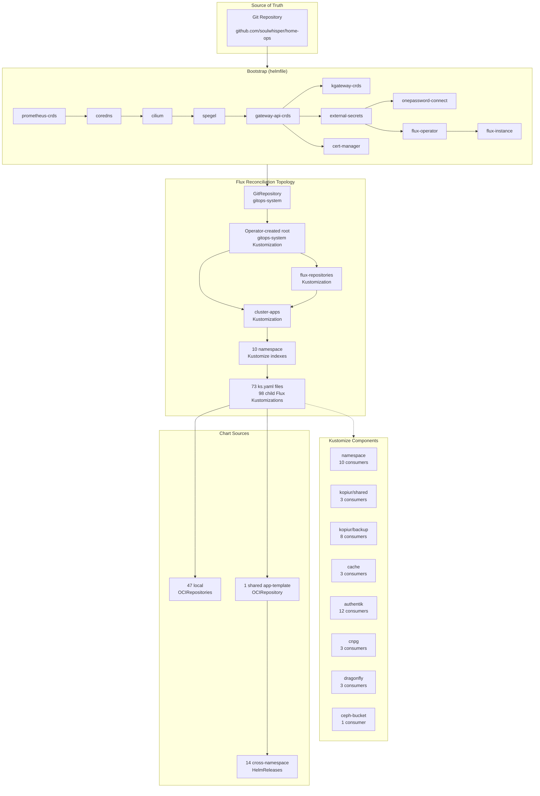

# Cluster Architecture

## Overview

The home-ops Kubernetes cluster runs on Talos Linux, managed entirely through GitOps with Flux CD. Every resource — from cluster-wide operators to individual applications — is declared in this repository and reconciled automatically. The architecture is built around four design principles:

1. **Git as the single source of truth** — Permanent application changes flow through Flux; Helmfile installs the initial bootstrap releases.
2. **Composability through Kustomize** — Eight reusable Kustomize Components encode cross-cutting concerns so individual applications stay lean.
3. **OCI-first chart sourcing** — All Helm charts are pulled from OCI registries; legacy `HelmRepository` resources are eliminated entirely.
4. **Layered patching** — Three strategic patch layers inject defaults at the cluster level, eliminating boilerplate from every application definition.



## Flux Topology

The Flux Operator creates a root `gitops-system` Kustomization from the FluxInstance sync configuration. It reads two cluster-level Flux `Kustomization` resources, which in turn register shared chart sources and build the application indexes.

### GitRepository → Cluster Kustomizations

A single `GitRepository` named `gitops-system` watches the `main` branch of `github.com/soulwhisper/home-ops`. The sync configuration is declared by the [`flux-instance` HelmRelease](https://github.com/soulwhisper/home-ops/blob/main/kubernetes/apps/gitops-system/flux-instance/app/helmrelease.yaml):

```yaml
sync:
  kind: GitRepository
  url: https://github.com/soulwhisper/home-ops.git
  ref: refs/heads/main
  path: kubernetes/flux/cluster
```

The two cluster-level `Kustomization` resources live in [`kubernetes/flux/cluster/cluster.yaml`](https://github.com/soulwhisper/home-ops/blob/main/kubernetes/flux/cluster/cluster.yaml):

| Kustomization       | Path                             | Depends On          | Purpose                                                |
| ------------------- | -------------------------------- | ------------------- | ------------------------------------------------------ |
| `flux-repositories` | `./kubernetes/flux/repositories` | _(none)_            | Registers shared OCI chart sources                     |
| `cluster-apps`      | `./kubernetes/apps`              | `flux-repositories` | Builds namespace indexes, shared resources, and child Flux Kustomizations |

### Recursive Discovery

Neither [`kubernetes/apps/`](https://github.com/soulwhisper/home-ops/tree/main/kubernetes/apps) nor [`kubernetes/flux/cluster/`](https://github.com/soulwhisper/home-ops/tree/main/kubernetes/flux/cluster) has a root `kustomization.yaml`. Flux autogenerates these build entrypoints by discovering manifests and explicit Kustomize indexes. Adding resources under an auto-discovered root can therefore affect deployment; `apps/` is not an inactive definition library.

The 10 namespace directories each have an explicit **Kustomize index**, not a separate namespace-level Flux Kustomization. For example, the [`monitoring-system` index](https://github.com/soulwhisper/home-ops/blob/main/kubernetes/apps/monitoring-system/kustomization.yaml) selects application `ks.yaml` files and shared namespace components. Its `namespace: monitoring-system` injects `metadata.namespace` into the selected namespaced objects. All **98 child Flux Kustomizations** omit `metadata.namespace` in their source and rely on this index; `spec.targetNamespace` controls their rendered resources, not the namespace of the Flux Kustomization itself.

There are **73 `ks.yaml` definition units**, containing one or more Flux Kustomizations each, and **72 HelmReleases**. A `ks.yaml` selects resource build paths such as `app/`, `cluster/`, `drivers/`, or `config/`; it is not interchangeable with an `app/kustomization.yaml`, which builds workload resources. For example, [`rook-ceph/ks.yaml`](https://github.com/soulwhisper/home-ops/blob/main/kubernetes/apps/storage-system/rook-ceph/ks.yaml) defines three child Kustomizations. The [`servitor-apps` index](https://github.com/soulwhisper/home-ops/blob/main/kubernetes/apps/servitor-apps/kustomization.yaml) also includes a nested `mcp/` index.

The source/static count is **100 Flux Kustomizations** (98 children plus the two in `cluster.yaml`). The operator-created root adds one, giving **101 in the deployed topology**. See the [Application Catalog](../application/catalog.md) for definition paths and counts, and [Storage](storage.md) for data ownership and lifecycle boundaries.

To inspect an application's composed output from the repository root:

```shell
just k8s render-ks servitor-apps open-webui
```

This runs `flate build ks --namespace servitor-apps open-webui` without applying resources. A plain `kustomize build .../app` does not include the parent namespace index, cluster patches, or Flux `spec.components` and substitution. In contrast, `just k8s apply-ks <namespace> <name>` applies rendered resources, and `just reconcile` requests root reconciliation; both mutate the cluster and are not validation commands.

### Flux Controller Tuning

The [FluxInstance configuration](https://github.com/soulwhisper/home-ops/blob/main/kubernetes/apps/gitops-system/flux-instance/app/helmrelease.yaml) sets:

- **Concurrency**: kustomize `4`, helm `2`, source `4`
- **Interval jitter**: 20% for those three controllers
- **Resources**: each requests `100m` CPU and `256Mi` memory; source has a `1Gi` memory limit, kustomize and helm each have `2Gi`
- **In-memory builds**: Kustomize temporary workspace uses a memory-backed `emptyDir` capped at `512Mi`
- **Helm caching**: source-controller caches up to 10 charts with a 60m TTL and 5m purge interval
- **Feature gates**: kustomize enables `CancelHealthCheckOnNewRevision`; helm enables `OOMWatch` and `DisableChartDigestTracking`

## Strategic Patching System

The `cluster-apps` Kustomization applies three strategic patches to its 98 child Flux Kustomizations. They are defined in [`cluster.yaml`](https://github.com/soulwhisper/home-ops/blob/main/kubernetes/flux/cluster/cluster.yaml); the effective configuration includes these patches, not just the local `ks.yaml`.

### Layer 1: Kustomization Defaults (managed annotation)

**Target**: Any `Kustomization` with annotation `config.home-ops.io/managed=true`

All 98 child Flux Kustomizations carry this annotation. The patch sets:

```yaml
spec:
  interval: 1h
  timeout: 5m
  sourceRef:
    kind: GitRepository
    name: gitops-system
    namespace: gitops-system
  prune: true
```

`wait` is deliberately not injected: unset falls back to the CRD default
(`false`), so an app that needs dependency-ordered readiness can still set
`wait: true` in its own `ks.yaml` — an injected default would silently
override it.

These scalar values override local declarations. In particular, [`flux-operator`](https://github.com/soulwhisper/home-ops/blob/main/kubernetes/apps/gitops-system/flux-operator/ks.yaml), [`flux-instance`](https://github.com/soulwhisper/home-ops/blob/main/kubernetes/apps/gitops-system/flux-instance/ks.yaml), and [`coredns`](https://github.com/soulwhisper/home-ops/blob/main/kubernetes/apps/kube-system/coredns/ks.yaml) declare `prune: false` locally, but all three have effective `prune: true`, as do all 98 children. The local value is not deletion protection; changes that remove a core Kustomization or alter its ownership must account for its effective prune behavior.

### Layer 2: Baseline Infrastructure Dependencies (deps label)

**Target**: Any `Kustomization` with label `config.home-ops.io/deps=infra`

The 37 child Kustomizations carrying this label use a uniform four-item infrastructure gate:

```yaml
spec:
  dependsOn:
    - name: cert-manager
      namespace: security-system
    - name: onepassword-connect
      namespace: security-system
    - name: rook-ceph-cluster
      namespace: storage-system
    - name: kopiur
      namespace: storage-system
```

This patch intentionally **replaces** the local `dependsOn` list; it does not append or merge entries. For example, a `ks.yaml` that declares `cnpg-cluster`, `dragonfly-operator`, and a shared NFS claim still resolves to exactly the four entries above. Children without this label retain their local dependencies. A `sourceRef` to `gitops-system` identifies the Git source; it is not a `dependsOn` edge.

Keep `deps=infra` when the uniform four-item gate is sufficient. Omit it
only for producer-specific prerequisites that the replacing patch would
otherwise erase. The ToolHive MCP chain has these explicit exceptions:

| Kustomization | Dependency policy | Required direct prerequisites |
| --- | --- | --- |
| `toolhive` | Explicit | `toolhive-crds` |
| `toolhive-config` | Explicit | `toolhive` |
| `toolhive-crds` | Keep `deps=infra` | Uniform infrastructure gate; no producer-specific exception |

Do not copy infrastructure dependencies already guaranteed by these
producer chains. CNPG supplies `cert-manager`, `onepassword-connect`, and
`rook-ceph-cluster` transitively. ToolHive and its configuration inherit
the infrastructure gate through `toolhive-crds`, and MCP consumers inherit
it through their providers. Infrastructure does not depend on monitoring
applications. The root patch and the
policies of unrelated Kustomizations remain unchanged.

### Layer 3: HelmRelease Defaults (all child Kustomizations)

**Target**: Every child `Kustomization` under `cluster-apps`

This patch injects a `patches` block into each application `Kustomization` that targets all `HelmRelease` resources within that app:

```yaml
spec:
  maxHistory: 1
  install:
    crds: CreateReplace
    strategy:
      name: RetryOnFailure
    remediation:
      retries: -1
  rollback:
    cleanupOnFail: true
  upgrade:
    cleanupOnFail: true
    crds: CreateReplace
    strategy:
      name: RemediateOnFailure
    remediation:
      remediateLastFailure: true
      retries: 3
  uninstall:
    keepHistory: false
```

Key behaviors this enforces cluster-wide:

- **CRD lifecycle**: Helm creates/replaces CRDs included by the selected chart (`CreateReplace`).
- **Install strategy**: `RetryOnFailure` retries failed installs; the patch also sets `install.remediation.retries: -1`.
- **Upgrade strategy**: `RemediateOnFailure` with 3 remediation retries and cleanup on failure.
- **History hygiene**: `maxHistory: 1` and `keepHistory: false` prevent Helm release history accumulation.

## OCI-First Strategy

All Helm charts are sourced from OCI registries. The legacy `HelmRepository` CRD is eliminated — every chart reference uses `OCIRepository` exclusively.

### Own OCIRepositories (47)

The application tree declares 47 local `OCIRepository` resources alongside their HelmReleases in resource build directories (`app/`, `cluster/`, `drivers/`, and others). They pull charts directly from their publishers' OCI registries; the shared app-template source brings the total to 48:

| Namespace         | Count | Example Charts                                                                                                                                                                                                                                        |
| ----------------- | ----- | ----------------------------------------------------------------------------------------------------------------------------------------------------------------------------------------------------------------------------------------------------- |
| kube-system       | 10    | cilium, coredns, spegel, frr-k8s, descheduler, reloader, metrics-server, gateway-api-crds, intel-device-plugins (operator + GPU)                                                                                                                       |
| security-system   | 4     | authentik, cert-manager, external-secrets, onepassword-connect                                                                                                                                                                                        |
| storage-system    | 6     | rook-ceph (app + cluster + drivers), kopiur, snapshot-controller, csi-driver-nfs                                                                                                                                                     |
| database-system   | 3     | cloudnative-pg, plugin-barman-cloud, dragonfly-operator                                                                                                                                                                                               |
| networking-system | 5     | kgateway (app + CRDs), agentgateway (app + CRDs), externaldns                                                                                                                                                                                         |
| monitoring-system | 14    | victoria-metrics (operator + cluster + app), victoria-logs (app + collector), victoria-traces, kube-state-metrics, node-exporter, prometheus-crds, blackbox-exporter, smartctl-exporter, opentelemetry-collector, silence-operator, robusta |
| gitops-system     | 3     | flux-operator, flux-instance, tuppr (system-upgrade-controller)                                                                                                                                                                                       |
| others            | 2     | toolhive (app + CRDs)                                                                                                                                                                                                            |

The `OCIRepository` fetches only the chart layer via `layerSelector` with `operation: copy`, which extracts the Helm chart tarball from the OCI manifest without pulling unrelated layers.

### App-Template Pattern (25 Cross-Namespace References)

For applications that don't need a custom Helm chart, the **app-template** pattern is used. A single `OCIRepository` is defined in [`kubernetes/flux/repositories/app-template.yaml`](https://github.com/soulwhisper/home-ops/blob/main/kubernetes/flux/repositories/app-template.yaml):

```yaml
apiVersion: source.toolkit.fluxcd.io/v1
kind: OCIRepository
metadata:
  name: app-template
  namespace: gitops-system
spec:
  interval: 10m
  layerSelector:
    mediaType: application/vnd.cncf.helm.chart.content.v1.tar+gzip
    operation: copy
  ref:
    tag: x.y.z # pinned here; renovate-managed
  url: oci://ghcr.io/bjw-s-labs/helm/app-template
```

Applications reference this chart from any namespace using `chartRef` with an explicit namespace:

```yaml
spec:
  chartRef:
    kind: OCIRepository
    name: app-template
    namespace: gitops-system
```

This cross-namespace reference is used by 21 application-facing HelmReleases across 5 namespaces (four further utility releases — restarters and database helpers — consume the same shared chart and are not listed):

| Namespace         | Count | Apps |
| ----------------- | ----- | ---- |
| monitoring-system | 2     | vmware-exporter, webhook-relay |
| networking-system | 1     | mcp-guardrails |
| selfhosted-apps   | 8     | bambuddy, firecrawl (+database), homepage, manyfold, obico-ml, searxng, trendradar |
| servitor-apps     | 4     | covel, diceframe, open-webui, playwright |
| smarthome-apps    | 6     | frigate, home-assistant (app + sgcc), mosquitto, scrypted, zigbee2mqtt |

The `flux-repositories` Kustomization is a dependency of `cluster-apps` and registers the shared source. It sets `wait: false`, so this edge does not itself wait for the OCI artifact to become ready; helm-controller resolves chart source readiness.

## Kustomize Component System

Eight Kustomize Components encode cross-cutting concerns as reusable building blocks. Applications declare which components they need in their `ks.yaml` — the component injects all required resources automatically.

### Component: namespace (10 consumers)

**Path**: [`kubernetes/components/namespace/`](https://github.com/soulwhisper/home-ops/tree/main/kubernetes/components/namespace)

Every namespace Kustomize index includes this component. It provides:

1. **Namespace resource** with label `kustomize.toolkit.fluxcd.io/prune: disabled` — excludes the Namespace itself from Flux pruning, not the objects inside it.
2. **Alert resources** — Flux `Alert` and `Provider` definitions that send notifications to the notification-controller for all Flux resources in the namespace.

```yaml
# kubernetes/components/namespace/labels.yaml
apiVersion: v1
kind: Namespace
metadata:
  name: _
  labels:
    kustomize.toolkit.fluxcd.io/prune: disabled
```

The `name: _` is a Kustomize placeholder. The namespace index's `namespace:` transformer sets the actual Namespace name and namespaces the Alert and Provider; this is not Flux `postBuild` substitution.

### Component: kopiur/shared (3 consumers)

**Path**: [`kubernetes/components/kopiur/shared/`](https://github.com/soulwhisper/home-ops/tree/main/kubernetes/components/kopiur/shared)

Combines the shared kopiur namespace resources. It patches the namespace with `kopiur.home-operations.com/privileged-movers: "true"` for uid-0/DAC_OVERRIDE backup movers, and injects a namespace-level `ExternalSecret` that pulls the kopia repository password and S3 access keys (NAS VersityGW) from 1Password into the `kopiur-repository-secret` Secret. The shared `ClusterRepository` itself lives with the kopiur app at `kubernetes/apps/storage-system/kopiur/repository/clusterrepository.yaml`.

### Component: kopiur/backup (8 consumers)

**Path**: [`kubernetes/components/kopiur/backup/`](https://github.com/soulwhisper/home-ops/tree/main/kubernetes/components/kopiur/backup)

It provisions the backup-and-recovery pipeline for a stateful application:

| Resource                | Purpose                                                                                 |
| ----------------------- | --------------------------------------------------------------------------------------- |
| `PersistentVolumeClaim` | Creates the application's data PVC (claims the `Restore` populator via `dataSourceRef`) |
| `SnapshotPolicy`        | The backup recipe: CSI snapshot copy method, zstd-fastest, keep-daily 14                |
| `SnapshotSchedule`      | Cron invocation of the policy (every 6h, `KOPIUR_SCHEDULE` overridable)                 |
| `Restore`               | Volume populator: attempts the latest snapshot, continuing without one when none exists |

Applications using this component store snapshots in the NAS VersityGW repository, independently of their live Ceph PVCs. The templates use `postBuild` substitution with `APP`. See [Storage](storage.md) for the repository, restore behavior, and the distinction between rebuildable application configuration and important NAS files.

### Component: cache (3 consumers)

**Path**: [`kubernetes/components/cache/`](https://github.com/soulwhisper/home-ops/tree/main/kubernetes/components/cache)

Injects a rewarmable cache/scratch `PersistentVolumeClaim` on a two-replica `ceph-cache` NVMe pool. Replicas are placed on separate hosts so an OSD drain cannot make every copy unavailable during RBD teardown and the node reboot. Data loss on OSD failure is acceptable. Consumers mount it via `existingClaim`. Never use for durable data.

### Component: authentik (12 consumers)

**Path**: [`kubernetes/components/authentik/`](https://github.com/soulwhisper/home-ops/tree/main/kubernetes/components/authentik)

Injects a `TrafficPolicy` resource that configures kgateway to require Authentik SSO authentication for the application's route. Applications behind the single sign-on gateway include this component.

The policy enforces:

- Forward auth via Authentik's outpost
- Unauthenticated requests redirected to the Authentik login flow
- Session validation on every request

### Component: cnpg (4 consumers)

**Path**: [`kubernetes/components/cnpg/`](https://github.com/soulwhisper/home-ops/tree/main/kubernetes/components/cnpg)

Injects an ESO `Password` generator and an `ExternalSecret` for an application
using the shared PostgreSQL cluster. The application password is generated;
the username, database name, host and connection strings are templated from
`APP` and `CNPG_NAME`. The `app-user` item in 1Password supplies the administrator
password used by the application's initialization job. This component does not
create a separate PostgreSQL cluster per application.

### Component: dragonfly (3 consumers)

**Path**: [`kubernetes/components/dragonfly/`](https://github.com/soulwhisper/home-ops/tree/main/kubernetes/components/dragonfly)

Injects Dragonfly database resources for applications using Dragonfly (a Redis-compatible drop-in):

| Resource     | Purpose                                                      |
| ------------ | ------------------------------------------------------------ |
| `Dragonfly`  | Declares a Dragonfly instance with the application's name    |
| `PodMonitor` | Configures Prometheus metrics scraping for the Dragonfly pod |

Applications with caching or session storage requirements include this component.

Optional Flux substitution variables:

- `REDIS_MEM_REQUEST` — scheduler memory request (default `96Mi`)
- `REDIS_MEM` — memory limit (default `1024Mi`)
- `DRAGONFLY_LUA_FLAGS` — value for `--default_lua_flags` (default empty). Set
  `allow-undeclared-keys,disable-atomicity` for BullMQ-based apps when needed.

### Component: ceph-bucket (1 consumer)

**Path**: [`kubernetes/components/ceph-bucket/`](https://github.com/soulwhisper/home-ops/tree/main/kubernetes/components/ceph-bucket)

Injects an `ObjectBucketClaim` that provisions an S3-compatible bucket from the Rook-Ceph object store. Used by `open-webui`.

### Component Composition

Applications frequently stack multiple components. For example, an app that needs object storage, PostgreSQL, and Redis stacks:

```yaml
components:
  - ../../../../components/ceph-bucket # Object bucket for uploads
  - ../../../../components/cnpg # PostgreSQL database
  - ../../../../components/dragonfly # Redis cache
```

The only five-component stack is `open-webui` (`cache`, `authentik`, `cnpg`, `dragonfly`, `ceph-bucket`).

## Namespace Inventory

Application definitions are grouped into 10 namespace directories. The numbering below is an inventory, not a namespace-level reconciliation DAG:

| #   | Namespace           | Purpose                              | Key Resources                                                                                                                                                                                                                              |
| --- | ------------------- | ------------------------------------ | ------------------------------------------------------------------------------------------------------------------------------------------------------------------------------------------------------------------------------------------ |
| 1   | `kube-system`       | Cluster networking and node services | Cilium CNI, CoreDNS, Spegel mirror, FRR-K8s BGP, Intel GPU plugins, Reloader, Descheduler, Gateway API CRDs, Metrics Server                                                                                                |
| 2   | `security-system`   | Identity, certificates, secrets      | Authentik SSO, cert-manager, External Secrets Operator, 1Password Connect, native-policies (ValidatingAdmissionPolicies) |
| 3   | `storage-system`    | Persistent storage and backups       | Rook-Ceph (block + object), CSI NFS driver, kopiur, Snapshot Controller                                                                                                                                                   |
| 4   | `database-system`   | Database operators                   | CloudNativePG, Dragonfly Operator                                                                                                                                                                                     |
| 5   | `networking-system` | Ingress, DNS, API gateway            | kgateway (Envoy), Agent Gateway (AI agent routing), ExternalDNS, forgejo-proxy |
| 6   | `monitoring-system` | Observability                        | Victoria Metrics (operator + cluster), Victoria Logs, Victoria Traces, Prometheus CRDs, kube-state-metrics, node-exporter, blackbox-exporter, Smartctl exporter, OTel Collector, Silence Operator, Robusta, webhook-relay, KRR, VMware exporter |
| 7   | `servitor-apps`     | AI and development tooling           | Covel, DiceFrame, Open WebUI, Playwright, Toolhive, MCP definitions (11 units) |
| 8   | `smarthome-apps`    | Home automation                      | Home Assistant (app + SGCC), Frigate NVR, Zigbee2MQTT, Mosquitto MQTT, Scrypted, smarthome-nfs |
| 9   | `selfhosted-apps`   | Self-hosted web services             | SearXNG, Homepage, BambuBuddy, Manyfold, Obico ML, trendradar, Firecrawl, selfhosted-nfs |
| 10  | `gitops-system`     | Flux itself                          | Flux Operator, Flux Instance, System Upgrade Controller                                                                                                                                                                                    |

### Dependency Order

Reconciliation order comes from the Helmfile bootstrap `needs` graph and the effective child Flux `dependsOn` lists, not this namespace table. The `deps=infra` label selects the uniform four-dependency policy described above; unlabelled children retain their explicit dependencies. Namespace indexes select resources but do not act as Flux readiness gates.

## Bootstrap Chain

Before Flux can manage the cluster, Helmfile installs the foundational components. [`kubernetes/bootstrap/helmfile.yaml`](https://github.com/soulwhisper/home-ops/blob/main/kubernetes/bootstrap/helmfile.yaml) declares 11 releases wired into a dependency DAG via `needs:`:

```
prometheus-crds → coredns → cilium → spegel → gateway-api-crds
gateway-api-crds → kgateway-crds
                 → external-secrets → onepassword-connect
                 → cert-manager
external-secrets → flux-operator → flux-instance
```

### Why helmfile?

Flux cannot install itself. The bootstrap chain uses helmfile for the initial provisioning because:

1. Talos clusters start with no cluster services — not even a CNI.
2. CoreDNS is installed before Cilium (hubble-relay rendering requires cluster DNS to exist; it only becomes ready once Cilium provides pod networking).
3. Spegel provides the OCI registry mirror that subsequent chart pulls use.
4. Gateway API CRDs are needed by kgateway-crds, external-secrets, and cert-manager.
5. External Secrets and 1Password Connect provision the secrets that Flux and applications consume; cert-manager covers certificates, and timezones are owned by workloads (see [ADR 04](../decisions/timezone.md)).
6. Flux Operator and Flux Instance are the last step — once they're running, Flux takes over.

### Step Details

| Step                  | Chart                                                                | Values Source        | Purpose                                                                                               |
| --------------------- | -------------------------------------------------------------------- | -------------------- | ----------------------------------------------------------------------------------------------------- |
| 1. `prometheus-crds`  | `oci://ghcr.io/prometheus-community/charts/prometheus-operator-crds` | _(none)_             | Installs Prometheus Operator CRDs (ServiceMonitor, PodMonitor, etc.) before Victoria Metrics operator |
| 2. `coredns`          | `oci://ghcr.io/coredns/charts/coredns`                               | `values.yaml.gotmpl` | Cluster DNS — must exist before Cilium renders hubble-relay (`wait: false` until the CNI is up)       |
| 3. `cilium`           | `oci://quay.io/cilium/charts/cilium`                                 | `values.yaml.gotmpl` | eBPF-based CNI with Gateway API, BGP, and network policy support                                      |
| 4. `spegel`           | `oci://ghcr.io/spegel-org/helm-charts/spegel`                        | `values.yaml.gotmpl` | Stateless OCI registry mirror using P2P image distribution                                            |
| 5. `gateway-api-crds` | `oci://ghcr.io/wiremind/wiremind-helm-charts/gateway-api-crds`       | _(none)_             | Gateway API CRDs (GatewayClass, Gateway, HTTPRoute, etc.)                                             |
| 6. `kgateway-crds`    | `oci://ghcr.io/kgateway-dev/charts/kgateway-crds`                    | _(none)_             | kgateway CRDs (gateways themselves installed later by Flux)                                       |
| 7. `external-secrets` | `oci://ghcr.io/external-secrets/charts/external-secrets`             | `values.yaml.gotmpl` | Kubernetes External Secrets Operator — syncs secrets from 1Password                                   |
| 8. `cert-manager`     | `oci://quay.io/jetstack/charts/cert-manager`                         | `values.yaml.gotmpl` | Certificate management for cluster-wide TLS                                                           |
| 9. `onepassword-connect` | `oci://ghcr.io/1password/connect`                                 | `values.yaml.gotmpl` | 1Password Connect server backing the ClusterSecretStore                                               |
| 10. `flux-operator`   | `oci://ghcr.io/controlplaneio-fluxcd/charts/flux-operator`           | `values.yaml.gotmpl` | Manages Flux Instance lifecycle                                                                       |
| 11. `flux-instance`   | `oci://ghcr.io/controlplaneio-fluxcd/charts/flux-instance`           | `values.yaml.gotmpl` | Creates the GitRepository and Kustomization resources that begin GitOps reconciliation                |

### Values Templating

The bootstrap templates read the original application files rather than duplicating chart pins or values:

- [`templates/release.yaml.gotmpl`](https://github.com/soulwhisper/home-ops/blob/main/kubernetes/bootstrap/templates/release.yaml.gotmpl) reads `kubernetes/apps/<namespace>/<release>/app/ocirepository.yaml` for `spec.url` and `spec.ref.tag`.
- [`templates/values.yaml.gotmpl`](https://github.com/soulwhisper/home-ops/blob/main/kubernetes/bootstrap/templates/values.yaml.gotmpl) reads `kubernetes/apps/<namespace>/<release>/app/helmrelease.yaml` for `spec.values`.
- [`default.yaml`](https://github.com/soulwhisper/home-ops/blob/main/kubernetes/bootstrap/default.yaml) connects these templates to each release.

These paths and namespace/name identities are part of the bootstrap contract. Helmfile and Flux share the source values, while Flux also applies the reconciliation defaults described above. See [Bootstrap](../deployment/bootstrap.md) for the operational sequence.

### Bootstrap Secret

Before Helmfile runs, `just _bootstrap_apps` renders [`kubernetes/bootstrap/resources.yaml.j2`](https://github.com/soulwhisper/home-ops/blob/main/kubernetes/bootstrap/resources.yaml.j2), injects the 1Password values, decodes the credentials field, and applies the Namespace and Secret:

```yaml
apiVersion: v1
kind: Secret
metadata:
  name: onepassword-connect
  namespace: security-system
stringData:
  1password-credentials.json: op://DevOps/1password-api/credentials
  token: op://DevOps/1password-api/token
```

This secret is referenced by the external-secrets Operator to authenticate with 1Password Connect and provision all other secrets in the cluster.

## Dependency Injection Label System

Two custom labels and an annotation drive the strategic patching and component injection system:

### `config.home-ops.io/managed: "true"`

**Type**: Annotation
**Purpose**: Opts a `Kustomization` into Layer 1 strategic patching (Kustomization defaults).
**Scope**: All 98 child Flux Kustomizations in 73 `ks.yaml` files.

Without this annotation, a Kustomization would not receive the automatic `sourceRef`, `prune`, `interval`, and `timeout` defaults. Infrastructure-only Kustomizations (like `flux-repositories`) omit it intentionally.

### `config.home-ops.io/deps: "infra"`

**Type**: Label
**Purpose**: Opts a `Kustomization` into Layer 2 strategic patching (baseline infrastructure dependencies).
**Scope**: 37 child Flux Kustomizations.

This label signals "I'm a workload that needs the core infra layer." Infrastructure components themselves (e.g., cert-manager, rook-ceph, cnpg-operator) omit this label — they _are_ the infra, so they only carry `managed: "true"`.

### Combined Effect

A typical application `ks.yaml` with both markers receives:

1. **From Layer 1** (`managed` annotation): `sourceRef`, `prune: true`, `interval: 1h`, `timeout: 5m`
2. **From Layer 2** (`deps=infra` label): replacement `dependsOn` list (cert-manager, onepassword-connect, rook-ceph-cluster, kopiur)
3. **From Layer 3** (automatic): HelmRelease defaults (CRD management, retry, remediation, rollback)

The local `ks.yaml` declares the path, target namespace, labels, dependencies, components, and substitution inputs. Its effective behavior includes the namespace index and root patches; for labelled children, local dependencies are replaced rather than preserved.

## Directory Structure

```
kubernetes/
├── apps/                          # Auto-discovered root; no kustomization.yaml
│   ├── kube-system/
│   │   ├── kustomization.yaml     # Namespace index + shared components
│   │   └── <app>/                 # Definition unit
│   │       ├── ks.yaml            # One or more Flux Kustomizations
│   │       ├── app/               # Resource build entrypoint
│   │       │   ├── helmrelease.yaml
│   │       │   ├── ocirepository.yaml
│   │       │   └── kustomization.yaml
│   │       └── <other-build>/     # Optional cluster/, drivers/, config/, etc.
│   ├── security-system/           #  2. Identity, certificates, secrets
│   ├── storage-system/            #  3. Persistent storage and backups
│   ├── database-system/           #  4. Database operators
│   ├── networking-system/         #  5. Ingress, DNS, API gateway
│   ├── monitoring-system/         #  6. Observability stack
│   ├── servitor-apps/             #  7. AI and development tooling
│   ├── smarthome-apps/            #  8. Home automation
│   ├── selfhosted-apps/           #  9. Self-hosted web services
│   └── gitops-system/             # 10. Flux itself
├── bootstrap/                     # Pre-Flux cluster provisioning
│   ├── helmfile.yaml              #   11-release bootstrap DAG
│   ├── default.yaml               #   Release template inheritance
│   ├── resources.yaml.j2          #   1Password Connect secret template
│   └── templates/                 #   Chart/tag and values bridges to app sources
├── components/                    # Reusable Kustomize Components
│   ├── namespace/                 #   Namespace + alerts (10 consumers)
│   ├── kopiur/shared/             #   Namespace-level kopia repo credentials (3 consumers)
│   ├── kopiur/backup/             #   PVC backup pipeline (8 consumers)
│   ├── cache/                     #   Rewarmable cache PVC on ceph-cache (3 consumers)
│   ├── authentik/                 #   SSO traffic policy (12 consumers)
│   ├── cnpg/                      #   PostgreSQL secret (4 consumers)
│   ├── dragonfly/                 #   Redis-compatible cache (3 consumers)
│   └── ceph-bucket/               #   S3 object bucket (1 consumer)
└── flux/                          # Flux cluster configuration
    ├── cluster/                   # No root kustomization.yaml; Flux autogenerates
    │   └── cluster.yaml           #   flux-repositories + cluster-apps Kustomizations
    └── repositories/
        ├── kustomization.yaml     #   Shared OCI source registration
        └── app-template.yaml      #   bjw-s app-template OCIRepository
```

## Talos Integration

The cluster runs on Talos Linux, a minimal, API-driven Kubernetes OS. Talos configuration lives in `infrastructure/talos/` and is not managed by Flux — node configuration is applied declaratively via `talosctl apply-config`.

Talos provides:

- **Immutable root filesystem** — no package manager, no SSH, no shell access on nodes
- **API-driven management** — all configuration changes flow through the Talos API
- **Automatic upgrades** — tuppr runs under the `system-upgrade-controller` release in `gitops-system`, using [`TalosUpgrade` and `KubernetesUpgrade` resources](https://github.com/soulwhisper/home-ops/tree/main/kubernetes/apps/gitops-system/system-upgrade-controller/plans)
- **NVMe storage** — M.2 NVMe SSDs across all nodes provide high-performance local storage for Rook-Ceph
- **Image pulls capped** — kubelet `maxParallelImagePulls: 2`; EPHEMERAL and etcd share the system NVMe, and unbounded pull waves stalled etcd fsync into leader-election restarts. Containerd layer downloads are additionally capped at `max_concurrent_downloads = 1` (`CRICustomizationConfig/base` in `infrastructure/talos/prod/`) as a canary mitigation: the 2026-10-18T22:39Z controller exits coincided with a single ~592 MB Firecrawl pull and nvme1n1 latency. The cap bounds download parallelism only, not unpack I/O. Real-rollout verification: applying the config regenerates the CRI config and restarts CRI without a node reboot — confirm `talosctl -n <node> read /etc/cri/containerd.toml` shows `max_concurrent_downloads = 1`, then watch the next large image pull for serialized layer downloads and absence of nvme1n1 latency spikes

The cluster uses Cilium as the CNI in native routing mode (no overlay), leveraging Talos's default network configuration and BGP peering via FRR-K8s for LoadBalancer service IP advertisement.

## Renovate Integration

[Renovate](https://github.com/renovatebot/renovate) monitors the repository for dependency updates across all layers:

- **OCIRepository tags** in `ocirepository.yaml` files
- **Container image tags** in HelmRelease values
- **Bootstrap chart versions and values** reuse the application sources through Helmfile templates; there are no separate chart pins in `helmfile.yaml`
- **Talos and Kubernetes versions** in tuppr upgrade resources

Renovate opens pull requests when updates are detected. The local
[`autoMerge.json5` rules](https://github.com/soulwhisper/home-ops/blob/main/.renovate/autoMerge.json5)
use `platformAutomerge: true` and `ignoreTests: false` for eligible updates;
major updates and infrastructure minor updates require manual merge, except
for explicitly listed package exceptions. Merged application changes are
picked up by Flux on its normal source and reconciliation intervals. These
rules do not guarantee serialized rollouts or immediate convergence.
