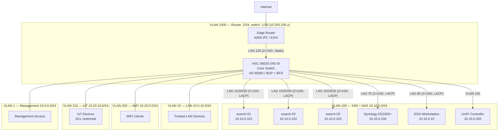

##  Network Architecture

The network is built around an enterprise-grade Layer 3 core switch with eBGP + BFD to the Kubernetes cluster, VLAN segmentation for security isolation, and 10G LACP bonds for all storage and compute paths.

### Physical Topology

```
                  ┌─────────────┐
                  │   Internet   │
                  └──────┬──────┘
                         │ PPPoE
                  ┌──────▼──────┐
                  │ Edge router │
                  │  (N305 IPC) │
                  │ NTP/DNS/VPN │
                  └──┬──────┬───┘
                     │      │
            ┌────────▼──┐ ┌─▼──────────┐
            │ ESXi Host │ │ 10G Transit │
            │ (VMs)     │ │ VLAN 1000   │
            └───────────┘ └──────┬──────┘
                                 │
                  ┌──────────────▼──────────────┐
                  │    H3C S6520-24S-SI          │
                  │    Core Switch (AS 65000)     │
                  │    BGP + BFD + LACP           │
                  └──┬───────┬───────┬───────┬────┘
                     │       │       │       │
            ┌────────▼┐ ┌───▼──┐ ┌──▼───┐ ┌▼────────┐
            │exarch-01│ │ex-02 │ │ex-03 │ │Synology │
            │.101     │ │.102  │ │.103  │ │NAS .100 │
            │2×10G LAG│ │2×10G │ │2×10G │ │2×10G LAG│
            └─────────┘ └──────┘ └──────┘ └─────────┘
            VLAN 100 (10.10.0.0/24) — K8S + NAS
```

| Device             | Role                                  | NIC                   | Uplink                  |
| ------------------ | ------------------------------------- | --------------------- | ----------------------- |
| H3C S6520-24S-SI   | L3 core switch, BGP router (AS 65000) | 24×10G SFP+           | 2×10G static LAG to router |
| Miniforum MS-01 ×3 | Talos K8s control-plane + worker      | Intel X710 2×10G SFP+ | 2×10G LACP per node     |
| N305 IPC           | ESXi host for the edge router       | 2.5G RJ45             | Edge router VM + management |
| Synology DS1825+   | NAS (NFS, S3, Docker)                 | 2×10G SFP+ (ext card) | 2×10G LACP              |
| SANTAK TG-Box 850  | UPS (NUT)                             | USB                   | —                       |



### VLAN Segmentation

The core switch enforces strict L3 isolation between security domains. Inter-VLAN routing is handled by the switch itself; VLAN 1000 provides the transit link to the edge router for WAN egress.

| VLAN | Name       | Subnet          | Gateway      | Purpose                                         | DHCP             |
| ---- | ---------- | --------------- | ------------ | ----------------------------------------------- | ---------------- |
| 1    | Management | 10.0.0.0/24     | 10.0.0.1     | Switch mgmt, ESXi, UniFi, OOB access            | Yes (switch)     |
| 10   | LAN        | 10.0.10.0/24    | 10.0.10.1    | Trusted wired LAN                               | Edge router          |
| 100  | K8S / NAS  | 10.10.0.0/24    | 10.10.0.1    | Kubernetes nodes, NAS, workstation, BGP peering | Edge router on demand |
| 200  | WiFi       | 10.20.0.0/24    | 10.20.0.1    | Trusted wireless clients                        | Edge router          |
| 210  | IoT        | 10.20.10.0/24   | 10.20.10.1   | Untrusted IoT devices (ACL-isolated)            | Edge router          |
| 1000 | Transit    | Switch `10.255.255.1/30`; router `10.255.255.2/24` | — | Switch default route via `10.255.255.2` | Static |

**IoT filtering (IPv4):** On VLAN 210's L3 interface, inbound ACL 3500 permits DHCP broadcasts and DHCP, DNS, and ICMP to the gateway. It also permits UDP/123 to any destination and Aqara hub (`10.20.10.100`) traffic to WiFi before blocking other traffic to private ranges. Internet traffic is allowed except for direct TCP/UDP DNS on port 53. On VLAN 200's L3 interface, inbound ACL 3510 permits WiFi clients to reach the hub over IP and the rest of VLAN 210 over TCP 80/443 and ICMP. These ACLs do not filter IPv6 or traffic switched within the same VLAN. A 10 Mbps QoS policy caps IoT ingress on the access switch uplink.

### LACP Link Aggregation

All LACP bonds use **layer 3+4** hashing (`xmitHashPolicy: layer3+4`) for optimal distribution across diverse traffic patterns. Jumbo frames (MTU 9000) are enabled on the K8s, NAS, and router bonds.

| Bond ID | Devices          | Speed | Type                 | VLAN                | Description                        |
| ------- | ---------------- | ----- | -------------------- | ------------------- | ---------------------------------- |
| 10      | Ten-GE 1/0/1–2   | 2×10G | Dynamic LACP, access | 100                 | K8s node exarch-01                 |
| 20      | Ten-GE 1/0/3–4   | 2×10G | Dynamic LACP, access | 100                 | K8s node exarch-02                 |
| 30      | Ten-GE 1/0/5–6   | 2×10G | Dynamic LACP, access | 100                 | K8s node exarch-03                 |
| 70      | Ten-GE 1/0/13–14 | 2×10G | Dynamic LACP, access | 100                 | Synology NAS                       |
| 80      | Ten-GE 1/0/15–16 | 2×10G | Dynamic LACP, access | 100                 | ESXi workstation fiber             |
| 120     | Ten-GE 1/0/23–24 | 2×10G | Static LAG, trunk    | 10,100,200,210,1000 | Router fiber (ESXi VSS limitation) |

Ports are configured as **STP edge ports** on all access bonds, and the switch operates as the RSTP root bridge with BPDU protection enabled.

Management connectivity uses a dedicated access port (Ten-GE 1/0/19, VLAN 1) with broadcast/multicast/unicast suppression at 5% for OOB control of the MS-01 nodes via AMT.

### Talos Bring-up Networking

`just talos image prod` builds the maintenance ISO from the production
schematic, adding `ip=:::::bond0:dhcp` only to that ISO. Enable the edge
router's maintenance DHCP pool on VLAN 100 before booting. The temporary lease
is only for applying configuration; it need not match the final static address.

The production installer uses the same schematic without `ip=`. Each node's
`BondConfig` supplies its IPv4 address and default route. Disable the
maintenance DHCP pool after provisioning.

### BGP Design

The core switch and each Kubernetes node run eBGP to advertise the LoadBalancer CIDR.

| Component               | ASN   | Router ID | Peers                   |
| ----------------------- | ----- | --------- | ----------------------- |
| Core switch (Comware 7) | 65000 | 10.10.0.1 | 10.10.0.101, .102, .103 |
| FRR-K8s per node        | 65100 | (node IP) | 10.10.0.1               |

- **Advertised prefixes (FRR→switch):** LoadBalancer pool `10.10.0.128/27` (only prefix advertised)
- **Advertised prefixes (switch→FRR):** No connected routes are redistributed. The switch can re-advertise the selected LoadBalancer route to the other peers; FRR filters all inbound routes.
- **Timers:** The switch recovery script and FRR-K8s explicitly configure 60s keepalive and 180s hold, matching the negotiated timers on all three live sessions. BFD handles faster failure detection.

#### BFD Fast Failover

BFD runs between the switch's VLAN 100 SVI and each K8s node via FRR-K8s:

| Parameter         | Value            |
| ----------------- | ---------------- |
| TX interval       | 400ms            |
| RX interval       | 400ms            |
| Detect multiplier | 5 (2s detection) |
| Echo mode         | Disabled         |
| Min TTL           | 1                |

This provides 2-second failure detection for LoadBalancer service IP reachability, independent of BGP hold timers.

### Cilium Network

Cilium runs as the sole CNI with full kube-proxy replacement on a `netkit` datapath.

| Feature               | Configuration                                              |
| --------------------- | ---------------------------------------------------------- |
| Datapath              | `netkit` (Intel X710/X722 NICs, `i40e` driver)               |
| Routing               | Native (`autoDirectNodeRoutes`, `endpointRoutes`)          |
| Pod CIDR              | `10.100.0.0/17`                                            |
| Service CIDR          | `10.100.128.0/17`                                          |
| IPAM                  | Kubernetes host-scope                                      |
| kube-proxy            | Replaced (`kubeProxyReplacement: true`)                    |
| Socket LB termination | TCP + UDP (`lb-sock-terminate-all-protos`): sockets to deleted backends are destroyed so clients reconnect |
| Bandwidth management  | BBR congestion control, enabled                            |
| BIGTCP                | Disabled (`i40e` lacks BIG TCP support)                      |
| BPF clock probe       | Enabled                                                    |
| BPF map preallocation | Enabled (8% dynamic size ratio, distributed LRU)           |
| Masquerade            | BPF-based                                                  |
| PMTU discovery        | Disabled (packetization-layer)                             |
| LoadBalancer mode     | Hybrid (DSR + SNAT), Maglev hashing, native acceleration   |
| LoadBalancer IP pool  | `10.10.0.128/27` — advertised via BGP                      |
| Service topology      | Enabled                                                    |
| Hubble                | Enabled (relay ×2 replicas, UI, metrics + ServiceMonitors) |
| Hubble metrics        | DNS, drop, TCP, flow, port-distribution, ICMP, HTTP        |
| Gateway API           | Disabled (kgateway handles this)                           |
| L2 announcements      | Enabled (`CiliumL2AnnouncementPolicy/default` answers ARP for LB VIPs) |
| Envoy                 | Disabled                                                   |
| Devices               | `bond+` (binds to all bond interfaces)                     |
| Cluster ID            | 1, name: `main`                                            |

**Kernel tuning** (applied via Talos sysctls):

| Parameter                               | Value          | Purpose                    |
| --------------------------------------- | -------------- | -------------------------- |
| `net.core.netdev_max_backlog`           | 16384          | 10G NIC packet queue depth |
| `net.core.somaxconn`                    | 32768          | Listen backlog             |
| `net.ipv4.tcp_max_syn_backlog`          | 8192           | SYN queue per socket       |
| `net.core.rmem_max` / `wmem_max`        | 128MB          | Socket buffer maximums     |
| `net.ipv4.neigh.default.gc_thresh1/2/3` | 1024/2048/4096 | ARP table for BGP + Cilium |
| `sunrpc.tcp_slot_table_entries`         | 128            | NFS over 10G concurrency   |

**IRQ affinity:** Network IRQs for the `i40e` driver are pinned to P-cores 2–11 (i9-13900H) via a Talos static pod, avoiding contention with E-cores.

### Gateway Layer

Traffic ingress is handled by two Gateway API implementations deployed in the `networking-system` namespace.

#### kgateway (Envoy-based)

| Gateway             | LB IP       | External DNS Target         | Purpose                                       |
| ------------------- | ----------- | --------------------------- | --------------------------------------------- |
| `kgateway-internal` | 10.10.0.131 | `gateway-int.noirprime.com` | Internal services (media, gaming, monitoring) |
| `kgateway-external` | 10.10.0.132 | `gateway-ext.noirprime.com` | Public-facing (authentik route + HTTP→HTTPS redirect) |

The two kgateway gateways use the `kgateway` GatewayClass with TLS termination via cert-manager certificates (`noirprime-com-tls`). The internal gateway accepts routes from all namespaces on HTTPS; the external gateway serves only the authentik route and the HTTP→HTTPS redirect. Cilium LB IPAM assigns the LoadBalancer IPs from the `10.10.0.128/27` pool, and BGP advertises them to the switch.

#### AgentGateway (LLM + MCP Proxy)

`agentgateway-proxy` is a purpose-built Gateway API implementation for AI workload routing. In-cluster consumers use `http://agentgateway-proxy.networking-system.svc.cluster.local:80`; the LoadBalancer IP is dynamically assigned from the LB pool (currently `10.10.0.140`), and the gateway exposes only an HTTP:80 listener. Its API surface is also proxied to the intranet through `kgateway-internal` at `https://api.noirprime.com` (internal DNS, strict API-key auth at agentgateway). Model lanes route to the MacStudio inference host at 10.10.0.210 (`studio.homelab.internal`).

**LLM routing** — model dispatch on `/v1/chat/completions` (body `model` → synthesized `x-model` header):

| Match                | Backend               | Timeout | Guardrails |
| -------------------- | --------------------- | ------- | ---------- |
| `x-model: uncensored` | `llm-backend-uncensored` | 300s | no (open lane) |
| `x-model: agent`     | `llm-backend-agent`   | 900s    | yes        |
| `x-model: omni`      | `llm-backend-omni`    | 300s    | yes        |

**MCP routing** — tiered ToolHive virtual-MCP dispatch (group ↔ route ↔ key bound 1:1:1):

| Path          | Tier                                   |
| ------------- | -------------------------------------- |
| `/mcp/search` | search (open-webui: web/news/code)      |
| `/mcp/cluster`| cluster read-only (no in-cluster consumer; operator key) |
| `/mcp/agent`  | external operator agents (Forgejo RW)   |

The search + agent tiers carry the mcp-guardrails ExtMCP sidecar (FailClosed) — untrusted web content feeding an unguarded LLM lane, and operator agents reading alert-derived ticket content; cluster relies on guarded lanes + CEL allowlists + token/SA boundaries. Tool allowlists are enforced per tier via `backend.mcp.authorization` CEL (`config/mcp/filters.yaml`). The `persona` MCP tier is retired with hindsight (2026-11): its bank is called directly at `http://nas.homelab.internal:8888/mcp/persona`.

API key authentication is enforced via `AgentgatewayPolicy` in strict mode for all LLM and MCP routes — per-model keys on `/v1` (route-scoped, covering inference and discovery), per-group keys on `/mcp/*`. The gateway is the single choke point for auth, routing, guardrails, and observability.

### DNS Architecture

The LAN resolver forwards `homelab.internal` and the private view of
`noirprime.com` to PowerDNS at `10.10.0.100`. Names that require public answers
use public DNS. See the [AdGuard upstream rules](https://github.com/soulwhisper/home-ops/tree/main/infrastructure/openwrt#adguard-home-upstreams).
The edge router uses OpenClash TProxy with fake-IP disabled.

#### Static DNS — DNSControl

[DNSControl](https://github.com/soulwhisper/home-ops/tree/main/infrastructure/dnscontrol)
publishes both zones, including these existing `homelab.internal` records:

| Hostname                     | IP                  | Purpose                      |
| ---------------------------- | ------------------- | ---------------------------- |
| `exarch-01.homelab.internal` | 10.10.0.101         | K8s node                     |
| `exarch-02.homelab.internal` | 10.10.0.102         | K8s node                     |
| `exarch-03.homelab.internal` | 10.10.0.103         | K8s node                     |
| `k8s.homelab.internal`       | 10.10.0.101/102/103 | Round-robin cluster endpoint |
| `esxi.homelab.internal`      | 10.0.0.10           | ESXi management              |
| `zigbee.homelab.internal`    | 10.10.0.20          | Zigbee coordinator           |
| `nas.homelab.internal`       | 10.10.0.100         | Synology NAS                 |
| `unifi.homelab.internal`     | 10.10.0.200         | UniFi controller             |
| `studio.homelab.internal`    | 10.10.0.210         | MacStudio inference host     |
| `ns.homelab.internal`        | 10.10.0.100         | PowerDNS nameserver          |

#### Dynamic DNS — external-dns

The `externaldns-powerdns` HelmRelease updates Kubernetes records in the
private `noirprime.com` zone:

- **Sources:** `gateway-httproute`, `service`
- **Domain filter:** `noirprime.com`
- **Gateway filter:** `kgateway-internal`
- **Policy:** upsert-only
- **TXT prefix:** `k8s-int.`

### External Services

While the infrastructure is predominantly self-hosted, a small set of cloud services addresses chicken-and-egg problems, ensures critical-service availability independent of cluster status, and provides business continuity:

| Service                                   | Use                                                                                       | Cost        |
| ----------------------------------------- | ----------------------------------------------------------------------------------------- | ----------- |
| [1Password](https://1password.com/)       | Secrets via [External Secrets Operator](https://external-secrets.io/) (1Password Connect) | ~$36/yr     |
| [Cloudflare](https://www.cloudflare.com/) | Domain registrar, S3-compatible R2, Zero Trust tunnels                                    | Free        |
| [GitHub](https://github.com/)             | Repository hosting, CI/CD (Flux + Renovate)                                               | Free        |

**Total: ~$3/mo**

### NTP

Production Talos nodes use the edge router at `10.10.0.254` for NTP; the core
switch uses the same router at `10.255.255.2`. Chrony needs at least two
selectable upstreams to update its clock (`minsources 2`) and has no local
reference fallback.

VictoriaMetrics scrapes the [chrony metrics exporter](https://github.com/soulwhisper/home-ops/tree/main/infrastructure/openwrt) every 60 seconds.
The router clock offset and source reachability help distinguish upstream NTP
problems from clock drift on individual nodes.

### Key Design Decisions

- **eBGP over iBGP:** eBGP avoids the need for a full mesh or route reflector within the K8s cluster. BFD compensates for the lack of an IGP.
- **Static LAG for router:** The ESXi virtual switch does not support dynamic LACP negotiation, so the router uplink uses a static LAG with forced port membership.
- **netkit over vxlan:** netkit provides better throughput and lower latency on 10G hardware compared to encapsulated overlay modes. Combined with native routing and autoDirectNodeRoutes, pod-to-pod traffic takes the shortest L3 path.
- **Maglev LB hashing:** Provides consistent hashing for LoadBalancer services, minimizing connection disruption during backend changes.
- **IoT filtering at the core:** IPv4 ACLs enforce the listed exceptions between the IoT and WiFi VLANs without a separate physical switch.
